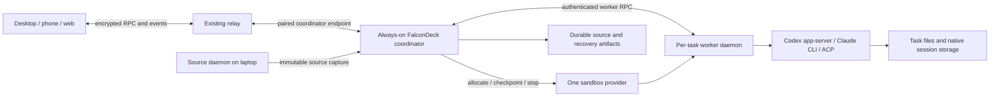

# Cloud copy implementation plan

Status: proposed, 2026-10-06. Based on [the harness review](CLOUD-HARNESS-REVIEW.md) and current repository source at `dcb02e35`. This plan changes no runtime behavior and authorizes no provisioning or deployment. Earlier [sandbox research](CLOUD-SANDBOXES.md) and [UX research](CLOUD-EXECUTION-UX.md) remain supporting material; the ownership and rollout decisions below take precedence for this proposal.

**Pilot scope updated 2026-10-30:** use [Cloud jobs: PR-only pilot](CLOUD-JOBS-PILOT.md) for the CTO's initial Quizgecko cleanup/test rollout. It starts from pushed Git revisions and ends in a reviewed PR, deferring dirty-source upload, session migration, sleep/restore and local import. The fuller experience below remains a later roadmap; it is not the minimum requirement for that pilot.

## Product outcome

Add **Cloud copy** beside **Project folder** and **Isolated copy**. A user can send an expensive build, unfamiliar change, or experimental task to an isolated cloud workspace, close the laptop, continue from a phone, and bring reviewed changes back later. Follow-ups use the same saved workspace and native agent conversation, even when the underlying worker has been replaced.

The first release should support **new Codex cloud tasks**, current working-state upload, native approvals, sleep/restore, and local change import. Offloading an existing task initially creates **a new cloud task with context**, leaving the original intact. Migrating the exact native local session is a separate, qualified feature. Claude follows on its CLI subprocess path; ACP follows per harness capability, rather than promising universal migration.

Use a small **always-on enrolled FalconDeck server as coordinator**, with one isolated worker per cloud task and reusable project environment recipes. Begin as a personal/BYO setup with one compute connection. This avoids requiring a managed FalconDeck account/billing service before proving the interaction. A coordinator temporarily running on the laptop is acceptable for development, but must never advertise laptop-off wake-up or phone launches.

## What exists and what needs building

The old [remote-host proposal](REMOTE-HOSTS.md) is not a reliable description of today's implementation. Current source already includes:

- [SSH provisioning](../crates/falcondeck-daemon/src/app/host_provisioning.rs), headless server installation and pairing;
- [desktop host connections](../apps/desktop/src/hosts.ts), merged snapshots and workspace-based `apiFor` routing in [App](../apps/desktop/src/App.tsx);
- an encrypted [RemoteHostClient](../packages/client-core/src/remote-host-client.ts), relay RPC and reconnect infrastructure;
- fixed-at-creation project-folder/isolated execution in [workspace operations](../crates/falcondeck-daemon/src/app/workspace_ops.rs), and [native provider dispatch](../crates/falcondeck-daemon/src/app/provider_runtime.rs);
- [handoff context](../packages/client-core/src/handoff-thread.ts), queued-turn persistence, and [isolated checkout shipping](../crates/falcondeck-daemon/src/ship.rs).

These are implementation building blocks, not proof of cloud support or of mobile multi-host parity. `ThreadSummary::working_directory()` currently returns a path on the owning daemon. `apiFor` chooses an owner by workspace. Neither can safely represent a remote worker merely by attaching a cloud-looking path to a local task.

Local [variants](../crates/falcondeck-daemon/src/variant.rs) use worktrees and an environment-file allowlist. Do not reuse this transfer policy unchanged: cloud capture must carry selected dirty source and must not automatically carry `.env` credentials.

## Architecture and ownership

The coordinator is an additional operating mode of the daemon, not a second conversation product. It owns cloud job IDs, routing, accepted command outboxes, environment versions, worker leases and artifact references. The worker runs the existing harness integrations and owns native conversation files. Durable checkpoints include those files plus the task checkout and necessary daemon metadata. The relay remains encrypted transport/replay, not a scheduler or conversation source of truth.

The coordinator may retain invalidatable task summaries and event projections. It must not build a FalconDeck transcript database. When a sleeping task's full native history cannot be read from saved native artifacts without starting compute, show that limitation and wake it on explicit history access. Saved diff artifacts should remain readable without waking.

For the pilot, place encrypted artifact storage on durable coordinator storage with a backup path; abstract artifact IO sufficiently to move to object storage later. Source upload is complete only after the durable artifact receipt is committed. Losing the source laptop after that point must not prevent execution or recovery.

Keep workers behind the coordinator. Clients pair with the coordinator once, not every transient worker. Give each worker short-lived credentials scoped to a single task and generation. Reuse encrypted relay RPC/event semantics for clients; specify a bounded, authenticated internal worker transport rather than using public unauthenticated daemon ports.

### Stable identity and protocol

Start protocol work in [falcondeck-core](../crates/falcondeck-core/src/lib.rs) and [client-core types](../packages/client-core/src/types.ts), then normalization, daemon and clients. Proposed names below are design contracts, not existing APIs:

| Record | Required responsibility |
|---|---|
| `CloudConnection` | Coordinator/compute account references and capabilities; secret references only in public snapshots |
| `CloudEnvironmentVersion` | Immutable image/toolchain, pinned harness versions, setup recipe and resource class; no task source or agent credentials baked into shared bases |
| `CloudSourceCapture` | Source host/project, commit and captured tree identifiers, timestamp, manifest/hash/size, exclusions and upload receipt |
| `CloudTask` | Stable cloud task ID, coordinator workspace/project identity, native session locator, current worker generation, lifecycle and checkpoint references |
| `CloudCheckpoint` | Workspace/native-state artifact, environment version, consistency/completion status, native-session identity and last successful save time |
| `CloudOperation` | Idempotency key, stage, accepted payload references, cancellation and recoverable error state |

Separate **execution destination** from **checkout isolation** internally; cloud is always isolated in v1. The three-choice UI can remain compact without overloading `ThreadVariant.path` as a cross-host address. Add a host-scoped task locator and operation handle so preparation exists before a native thread has been created. Scope caches/selection/approval identifiers by owner as well as thread ID; today's merged snapshots deduplicate bare IDs and must not misroute cross-host collisions.

Add an execution-routing seam before local `ProviderRuntime` dispatch. Local tasks keep their existing path; cloud task operations forward to the task's worker, where the same native backend runs. Route history, approvals, files, Git, attachments and interruption through that seam as well as Send. Cloud restore must bind the recorded native ID rather than start a fresh backend and attach an old title.

Represent cloud workspaces as coordinator-owned resources linked to the original project through provenance. Group them with that project in the sidebar while preserving routing to their actual owner. The source project can disappear or go offline without changing cloud ownership. Unknown protocol fields default safely; older clients must refuse unsupported cloud writes rather than silently execute locally.

## Interaction design

### Create and offload

1. Select **Cloud copy**. If needed, set up the coordinator, compute connection, agent account and project environment. Return to the unchanged composer draft afterward.
2. Show **Current working copy**, capture timestamp, and a small file/exclusion summary. Advanced source selection can use a pinned remote revision later. Show **Standard** or **Build** resources with configured CPU/RAM and a runtime budget; do not invent a precise cost total.
3. Send creates a durable operation. Inline stages are **Preparing files → Uploading → Starting workspace → Preparing tools → Running**. Cancellation and retry use the same operation identity; failed setup retains the prompt and attachments.
4. The task header shows **Cloud · environment name**, resource class, lifecycle and last saved time. Harness/model selection remains familiar. Changing an environment recipe affects future tasks, not the active task.

For an existing conversation, offer **Offload to cloud** as a context handoff. Preview “Starts a new cloud task with context from this task” and link the original. Capture files from that task's actual working directory, including an isolated variant if applicable. Bound context using existing handoff budgets, retain the authored prompt separately, and mark partial transcript context honestly. The existing handoff API validates a source in the same daemon workspace, so cross-host provenance needs its own explicit validation path; do not fabricate a local source thread to bypass that check.

Cloud tasks are an isolation choice for experimental work; native permission settings remain effective. The default environment gets project-scoped credentials and dependencies, not the laptop's full home directory, local MCP tools or production access. Surface unavailable tools during preparation.

### Follow up, stop and recover

Send targets the stable cloud task; the coordinator resumes its saved workspace and exact native session before dispatch. Mobile/web can attach directly to the coordinator while the laptop is off. A message requiring fresh local capture says **Source computer offline**; the user can deliberately use a labeled saved capture. It must not silently upload a cached “current” checkout.

Keep **Interrupt task**, **Sleep workspace**, **Archive task**, and **Delete cloud files** distinct. Archiving does not delete history. Sleep is permitted at a safe boundary; it saves first, then releases compute. A running turn or live approval keeps the worker available within its budget. At a hard provider deadline, controlled interruption and recovery replace any promise of preserving the live tool process.

| State / situation | User-facing behavior |
|---|---|
| Idle, saved | Sleep after configured grace; show last save |
| Sleeping, follow-up submitted | Waking workspace; prompt is durably queued |
| Waiting for approval | Normal approval card; reconnect sees the same live request |
| Coordinator unavailable | Controller offline; unsent message stays a draft |
| Worker lost | Recovering from last save; identify interrupted work |
| Restore failed / checkpoint absent | Retry recovery or explicitly create a fresh task; preserve artifacts |
| Authentication expired | Reconnect account; retain task and queued message |
| Results ready | Review changes / Bring back changes; retain saved result after sleep |

An approval response is bound to task, native request, worker generation and live turn. After process replacement, an old approval becomes stale; it cannot be replayed into a new request. Native resumption may produce a new approval. Never switch to bypass mode to keep a cloud task running.

### Bring changes back

Store the **captured starting tree**, not only Git HEAD. Compare cloud output against that tree so pre-existing dirty edits are not attributed to the cloud agent. Offer **Bring back changes** into a new local isolated checkout first, using a three-way import of cloud delta, captured base and present destination. Preserve binary files, deletions and executable bits. Conflicts remain in the import checkout; do not modify the original project while merely reviewing them. Reuse existing commit/merge review surfaces after validation.

Keep a durable result receipt and operation ID so retry cannot apply the same import twice. Applying code does not move the cloud conversation. PR creation follows once source-provider authorization and synthetic capture ancestry are handled; a private capture commit containing local dirt must not accidentally appear in a PR. Explicitly choose whether those original edits are part of the published change.

## Lifecycle, source and authentication contracts

- **Capture:** Git projects first. Export selected committed objects plus a normalized working-tree artifact without committing, checking out, staging or stashing in the user's repository. Preserve staged/unstaged information as provenance; cloud execution need not reproduce local index staging. Support unpublished commits without requiring GitHub. Detect concurrent source changes during capture and retry or report a changing source; never claim an atomic snapshot of actively edited files without verification. Detect unsupported LFS/submodules/symlink layouts before accepting a launch.
- **Transfer:** manifest-based, bounded, hashed and resumable. Use chunked background upload with authenticated grants; large artifacts must not become a single relay RPC that outlives its deadline. Specify this data path without exposing the daemon's loopback API publicly. Omit build outputs and credentials by default; present included eligible untracked source. Validate extraction paths and symlink boundaries on the receiver. Pending upload is not sufficient for laptop-off operation.
- **Worker:** stable in-worker project/home paths, immutable tool image version, task-private native storage. Model/account sign-in is a qualified headless login or separately supplied API credential; copying local OAuth/keychain files is not the v1 login path. Provider hosting credentials stay only on the coordinator. Keep repository and tool grants separate from model and compute grants.
- **Runtime ownership:** one live writer lease per cloud task. Heartbeats report worker generation and provider expiry. An expired lease alone does not prove the old process stopped: fence/terminate it before admitting a replacement writer, and reject stale generations at the gateway.
- **Persistence:** checkpoint at completed turn boundaries and before planned sleep/expiry, flushing native and daemon state through a qualified export/stop protocol. Record and verify the replacement checkpoint before deleting the previous one or terminating the source. Active-turn backups are not labeled consistent unless the harness supports that guarantee. Cold restore must fail closed if exact native resume is unavailable.
- **Dispatch:** distinguish accepted, dispatched and native-acknowledged commands. Unknown outcome after worker loss is **interrupted/ambiguous**, not automatic prompt replay; ask the user to resume or retry after checking native state. Commands may have external side effects. Durable outboxes improve delivery, not exactly-once tool execution.
- **Retention and budgets:** explicit idle/runtime/concurrency limits and checkpoint retention, visible before creation. Stop admitting new work when the remaining provider lifetime cannot safely run and save it. Failed saves keep available compute within budget and report the unsaved interval; hard loss can recover only the last verified checkpoint. Model usage and compute/storage charges remain separate.

## Delivery phases and acceptance gates

No calendar estimate until Phase 0 resolves runtime and credential compatibility. Each phase is a scoped change on main, with focused tests and repo-local autoreview; deploy only when requested. Keep cloud features gated off until the end-to-end gate passes.

### Phase 0 — qualify the smallest native cloud runtime

Build a disposable Linux worker running FalconDeck and **Codex app-server**. Use the existing enrolled-server path for the coordinator. Qualify one provider rather than shipping several: **Vercel is the initial candidate** from prior research; **Modal is the fallback** because BB supplies the closest inspected native-daemon checkpoint implementation. E2B remains a later benchmark, not a parallel integration project.

The candidate must prove detached execution, request/approval round trips, dirty files, native history, safe shutdown, cold exact-session restore, endpoint access control, resource sizing, expiry reporting and artifact recovery after the laptop disconnects. Record startup/setup/save/restore timings and document supported login modes. If it fails a required contract, use Modal against the same fixture and select the first passing implementation; do not reduce the product promise to fit a provider.

Current official [Vercel persistence](https://vercel.com/docs/sandbox/concepts/persistent-sandboxes), [Modal snapshots](https://modal.com/docs/guide/sandbox-snapshots), and [E2B persistence](https://docs.e2b.dev/sandbox/persistence) were rechecked October 6. Disk restoration and live memory continuation are different capabilities. Modal root snapshots exclude mounted volumes and now have configurable TTL with a finite default; encode retention explicitly. Pin the selected API/SDK version and record actual account limits during qualification.

**Gate:** a cloud-created native Codex session resumes on replacement compute with its files and history, without a replacement conversation or bypassed approval. Live provisioning is future implementation work and needs an authorized test account/budget.

### Phase 1 — cloud ownership, coordinator and worker control

Add the records, lifecycle reducer, idempotent operations and capability negotiation. Implement one provider adapter plus a deterministic fake. Keep adapter responsibilities small: create/inspect/start-worker/checkpoint/restore/stop/delete, expiry and resource capabilities. Place durable cloud metadata/outboxes alongside existing daemon operational persistence, not native transcript storage. Build worker authentication, fencing and restart reconciliation. Extend HTTP and encrypted RPC from one registered contract.

**Gate:** duplicate launch/response retries allocate one task; coordinator restart reconnects or restores it; stale workers cannot accept commands; provider/create/save failures retain recoverable metadata. Local task behavior stays unchanged.

### Phase 2 — current-source capture and first desktop task

Implement source capture/transfer and destination materialization before harness start. Add Settings → Cloud execution and project setup, the composer choice, preparation state, recoverable draft and task owner routing. Introduce cloud capability-aware history/files/diff paths instead of passing worker paths into local Git calls. Use shared semantic UI and [DESIGN.md](../DESIGN.md) product language.

**Gate:** a project with staged, unstaged and selected untracked edits reaches the worker without changing the local checkout/index; exclusions are visible; duplicate Send and cancel/upload failures preserve user work; permission requests function; the first task continues after the Mac disconnects.

### Phase 3 — durable follow-ups, sleep and phone access

Implement completed-turn checkpoints, safe sleep, wake-on-send, expiry drains and restore failure UX. Extend mobile and remote-web owner routing/pairing where parity is missing. An available coordinator is the prerequisite for offline-laptop actions; do not put wake-up logic exclusively in desktop. Bound snapshot payloads and recover reconnects from fresh daemon/native snapshots when relay replay has been pruned.

**Gate:** phone follow-up succeeds with the Mac off after worker replacement; same native session is resumed; disconnected live approval is answerable after reconnect; lost-process approval is rejected as stale; interrupted/ambiguous turns are not automatically duplicated. Power loss and snapshot failure expose the real recovery point.

### Phase 4 — saved review and safe local import

Persist baseline/output/diff artifacts; add review while sleeping and import to a new local checkout. Extend shipping deliberately rather than calling `ship_variant` with an unrelated remote path. Provide apply receipts, conflict handling and source/destination labels. PR support can be a follow-on after local import is reliable.

**Gate:** original local dirt is preserved, only cloud delta is imported, concurrent destination edits produce reviewable conflicts, binary/delete/mode changes survive, failed import keeps results, and duplicate import requests do not land work twice.

### Phase 5 — Claude, qualified ACP and offload handoff

Add Claude through the existing CLI backend and qualify its native storage/auth/restart behavior. Enable each ACP harness only for demonstrated cloud capabilities; unsupported native resume cannot masquerade as continuity. Ship contextual **Offload to cloud** using captured source/provenance and bounded handoff input. Keep the original session independently usable.

**Gate:** context-transfer limitations are visible; unsupported configuration/tools are identified before launch; each enabled harness passes create, approval, interrupt, sleep/restore and import fixtures. Exact local native-session transfer remains disabled until its own writer-lock/path/schema validation passes.

### Phase 6 — pilot polish and later expansion

Use pilot measurements to choose defaults for resource classes, idle grace and checkpoint/retention budgets. Add bounded logs and metrics for stage latency, save failures, unexpected termination and recovery outcomes without logging secrets or transcripts. Provide connection removal, orphan-worker cleanup and retained-artifact deletion controls. Run the full laptop-off journey before enabling by default.

Later work: pinned remote-revision launch, prepared-image publishing/prewarming, PR publishing, automations owned by the coordinator, additional providers, managed onboarding/billing, and explicitly qualified native-session migration. Persistent standalone servers remain an existing-host destination; do not add a shared mutable cloud machine mode merely to save provisioning time.

## Validation and immediate next implementation slice

Documentation validation for this plan is source inspection plus scoped autoreview; no runtime tests or live resources were used to write it. Implementation tests should focus on ownership and loss boundaries: lease fencing, capture consistency, command ambiguity, durable save ordering, stale approvals, owner-scoped caches and three-way import. Fake provider/worker tests cover failures deterministically; live qualification confirms contracts the fake cannot establish.

The next executable task is **Phase 0 only**: record the Linux/native-session and provider qualification results, with one bounded worker fixture and an explicit test budget. Its output is a passing contract, measured lifecycle timings, supported authentication and one chosen provider. That evidence unblocks protocol/runtime work without prematurely building a multi-provider platform.
